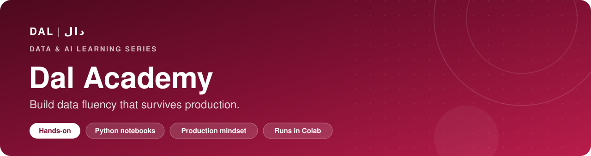
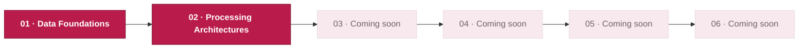

<p align="center">
  
</p>

<p align="center">
  <a href="#modules"></a>
  
  
  <a href="https://daldata.ai"></a>
</p>

<p align="center">
  <b>Hands-on notebooks that take you from raw data to production-grade data systems.</b><br>
  Every module pairs clear concepts with runnable code, real production notes, a lab, and a checkpoint.
</p>

<p align="center">
  <a href="#modules">Modules</a> ·
  <a href="#get-started">Get started</a> ·
  <a href="#how-each-module-works">How modules work</a> ·
  <a href="CONTRIBUTING.md">Contribute</a>
</p>

---

## Modules

| | Module | What you'll learn | Level | Open |
|:-:|---|---|---|:-:|
| **01** | [**Data Foundations & Data Types**](modules/01-data-foundations/) | Data forms, dtypes vs business meaning, profiling, data quality, schema evolution, data contracts | Foundation | [](https://colab.research.google.com/github/hanoufalmogri/Dal-Academy-Content/blob/main/modules/01-data-foundations/01-data-foundations.ipynb) |
| **02** | [**Data Processing Architectures**](modules/02-processing-architectures/) | Batch, micro-batch, streaming, event time, windows, state, idempotency, backpressure | Intermediate | [](https://colab.research.google.com/github/hanoufalmogri/Dal-Academy-Content/blob/main/modules/02-processing-architectures/02-processing-architectures.ipynb) |
| **03** | _Coming soon_ | | | |
| **04** | _Coming soon_ | | | |
| **05** | _Coming soon_ | | | |
| **06** | _Coming soon_ | | | |

### Learning path



## Get started

**Fastest way:** click **Open in Colab** next to any module. It runs in your browser with nothing to install.

<details>
<summary><b>Prefer to run locally?</b></summary>

<br>

You'll need Python 3.9 or newer.

```bash
git clone https://github.com/hanoufalmogri/Dal-Academy-Content.git
cd Dal-Academy-Content
python3 -m venv .venv
source .venv/bin/activate        # Windows: .venv\Scripts\activate
pip install -r requirements.txt
jupyter lab
```

All datasets are generated inside the notebooks, so nothing needs to be downloaded.

</details>

## How each module works

Every notebook follows the same rhythm, so you always know where you are:

| Step | What happens |
|---|---|
| 🎯 **Objectives** | What you'll be able to do by the end |
| 💡 **Concept** | The idea in plain language, with terms defined |
| 🧪 **Demonstration** | Runnable code on reproducible data |
| 🏭 **Production note** | How it shows up in real systems, and the common mistakes |
| 🛠️ **Lab** | A hands-on task you build yourself |
| ✅ **Checkpoint** | Questions to confirm you've got it |

## Questions or found a mistake?

[Open an issue](https://github.com/hanoufalmogri/Dal-Academy-Content/issues/new/choose) and pick **Content error** or **Question**. Include the module number and section.

---

<p align="center">
  <sub><b>DAL | دال</b> · Guiding a generation of data leaders · <a href="https://daldata.ai">daldata.ai</a></sub>
</p>
